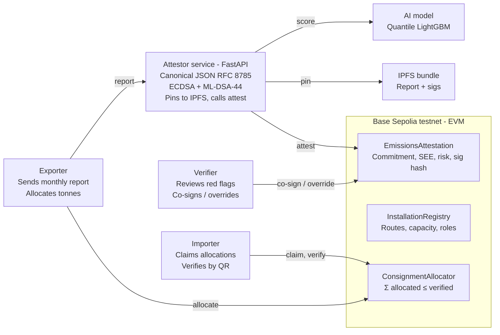

# EmbedProof — PRD

**As of:** 18 Oct 2026 · **Owner:** BD (Bhavya Dhoot)

---

## 1. Overview

EmbedProof turns a steel or cement mill's CO₂-per-tonne claim into a tamper-evident, quantum-safe certificate. AI checks the claim against independent evidence, and a smart contract makes it impossible to sell the same low-carbon tonne twice.

| Field | Value |
| --- | --- |
| Hackathon | [IEEE ClimateChain Global Hackathon 2026](https://ieee-climatechain-hack.devpost.com/) |
| Track | Track 1 — Carbon Markets & Emissions Transparency |
| Track builds hit | Blockchain-based verification · real-time emissions tracking · smart contracts to prevent double counting |
| Deadline | 25 Oct 2026, 17:00 UTC+3 (submit 24 Oct; 25 Oct is buffer) |
| Team | Solo (BD), student-eligible |
| Deliverables | Public GitHub repo · hosted demo · 3–5 min video · Devpost write-up |
| Positioning | Verifier copilot + anti-double-claim ledger. Not a carbon-credit marketplace, not accredited CBAM verification. |

**Why now:** CBAM's definitive phase started 1 Jan 2026, Türkiye's ETS regulation was gazetted 27 Aug 2026, and COP31 opens in Antalya on 9 Nov 2026, two weeks after the deadline.

---

## 2. Problem

EU importers of Turkish steel and cement now pay a carbon bill per tonne, but nobody can see the CO₂ in a steel coil, and no shared layer stops one verified low-carbon batch being claimed by two buyers.

| Pain | Evidence | Source |
| --- | --- | --- |
| Default-value penalty | Importers without verified actual data pay default values plus a 10% mark-up in 2026, 20% in 2027, 30% from 2028 | [EC CBAM definitive regime](https://taxation-customs.ec.europa.eu/carbon-border-adjustment-mechanism/cbam-definitive-regime_en) |
| Türkiye exposure | EU is Türkiye's largest trade partner; TR-ETS pilot (2026–27) covers power, cement, steel, aluminium, fertilizer — the same CBAM sectors | [ICAP TR-ETS](https://icapcarbonaction.com/en/ets/turkish-emission-trading-system) |
| Verifier scarcity | First accredited CBAM verifiers expected around Sept 2026; first annual declaration due 30 Sept 2027 | [EC CBAM](https://taxation-customs.ec.europa.eu/carbon-border-adjustment-mechanism/cbam-definitive-regime_en) |
| Fraud incentive | Traders report "unrealistic" verification reports from Asian exporters engineered to sit under the benchmark | [EUROMETAL, Apr 2026](https://eurometal.net/eu-steel-imports-ex-asia-risk-failed-cbam-verifications/) |
| Double-claiming gap | No registry tracks supplier-side per-batch allocation of verified tonnes across multiple EU importers | Gap identified in research; no counter-example found |

Embedded emissions are a credence good: the buyer cannot inspect them, and both exporter and importer gain from underreporting. The missing pieces are a plausibility check before attestation and a shared, tamper-evident allocation ledger after it.

> **Open question:** confirm the indicative ~€100/t default-value cost for Turkish steel against [iklim.gov.tr](https://iklim.gov.tr) before quoting it in the video.

---

## 3. Goals, non-goals and success metrics

The goal is a working prototype that a security-heavy IEEE panel scores highest on all five judging criteria, not a production CBAM product.

### Goals
1. Gate every emissions attestation behind an AI plausibility score and a verifier co-signature.
2. Enforce on-chain that tonnes allocated to consignments never exceed verified production for an installation-period.
3. Sign every report with ECDSA and ML-DSA-44 so the record stays tamper-evident for the years CBAM data is retained.
4. Keep confidential plant data off-chain; expose only commitments and risk bands.
5. Ship a demo a non-specialist understands in under four minutes.

### Non-goals
- Replacing EU-accredited verification under Reg. 2023/956.
- Issuing offsets or interacting with Article 6 corresponding adjustments.
- Measuring plant CO₂ from satellites. The model flags plausibility; it does not measure.
- Mainnet deployment, token economics, or a mobile app.

### Success metrics for the submission

| Metric | Target |
| --- | --- |
| Contract tests passing (allocation cap, double-claim revert, roles, pause) | 100%, ≥ 12 tests |
| End-to-end scenarios demoed live | 4: honest mill, implausible claim, double-claim blocked, tampered report |
| AI model evaluation reported | Held-out MAE and 90% interval coverage, with baseline |
| Threat model | STRIDE table with ≥ 6 threats and mitigations in README |
| Video length | 3:45–4:15 |
| Repo quickstart | `make demo` runs in under 60 s on a fresh clone |
| Judging criteria addressed as headings in Devpost text | 5 of 5 |

---

## 4. Target users and personas

The paying user is the Turkish exporter; the importer, verifier and regulator each get a read or co-sign role.

| Persona | Who | Job to be done | What EmbedProof gives them | Role in prototype |
| --- | --- | --- | --- | --- |
| Exporter (primary) | CBAM-sector Turkish mill, often an SME without consultancy budget | Prove actual low-carbon intensity so EU buyers avoid default values plus mark-up | Attested, signed per-batch intensity record importers trust; cheaper verification pre-screen | Submits reports, allocates tonnes to consignments |
| Importer / authorised CBAM declarant | EU steel or cement buyer | Audit-ready embedded-emissions data; certainty the tonnes aren't double-claimed | Public verification page by QR; allocation receipt on-chain | Claims allocations, verifies certificates |
| Accredited verifier | EU-accredited CBAM verifier or TR-ETS verifier | Prioritise site visits; defend sign-offs later | AI risk score with explanation; immutable co-signature trail | Reviews flags, co-signs or overrides with reason hash |
| Regulator | Türkiye Directorate of Climate Change | Cross-check TR-ETS reports against CBAM declarations | Read-only view of attested intensities per installation | Read-only observer role |
| Pilot channel | Istanbul Chamber of Commerce (hackathon sponsor) | Help member exporters comply | Onboarding path for SMEs | Named in write-up, not built |

---

## 5. User stories and key flows

Four flows carry the demo; every story below maps to one of them.

| ID | As a… | I want to… | So that… | Flow | Priority |
| --- | --- | --- | --- | --- | --- |
| US-1 | Exporter | Register my installation with its production route (BF-BOF, EAF, DRI-EAF) and capacity | My reports are checked against the right benchmark | Onboard | MVP |
| US-2 | Exporter | Submit a monthly production and emissions report (tonnes, direct and indirect CO₂, grid intensity) | I can get an attested specific embedded emissions (SEE) value | Attest | MVP |
| US-3 | Exporter | See the AI plausibility band and why my claim was green, amber or red | I can correct data before a verifier sees it | Attest | MVP |
| US-4 | Verifier | Review red-flagged reports with the SHAP explanation and either co-sign or override with a reason | Site-visit time goes to the riskiest claims | Attest | MVP |
| US-5 | Exporter | Allocate N tonnes from an attested batch to a consignment (importer, CN code, quantity) | Each importer receives a unique share of the verified production | Allocate | MVP |
| US-6 | Importer | Scan a QR on the certificate and see SEE, risk band, verifier, allocation holders and both signature checks | I can trust the figure without a login | Verify | MVP |
| US-7 | Importer | Be rejected when I try to claim tonnes already allocated to another importer | The same green tonne cannot be sold twice | Allocate | MVP |
| US-8 | Anyone | Edit one digit in the off-chain report and watch both signatures fail | I know the record is tamper-evident | Verify | MVP |
| US-9 | Regulator | View all attested intensities for an installation across periods | TR-ETS and CBAM figures can be cross-checked | Verify | Stretch |
| US-10 | Exporter | Prove SEE is below a benchmark without revealing the exact value | Confidential data stays private from competitors | Verify | Roadmap (ZK) |

**Flow: Attest** — Exporter submits report → attestor canonicalises JSON → model scores → if score ≤ threshold, attestor signs (ECDSA + ML-DSA-44), pins to IPFS, calls `attest()`; if above, status becomes `PendingVerifier` until US-4 resolves it.

**Flow: Allocate** — Exporter calls `allocate(batchId, consignmentId, importer, tonnes)` → contract checks `allocated + tonnes ≤ verifiedTonnes` → emits `Allocated` or reverts `DoubleClaimBlocked`.

**Flow: Verify** — Public page reads attestation and allocations from chain, fetches report from IPFS, recomputes keccak commitment, verifies ECDSA on-chain data and ML-DSA signature in-browser via WASM.

---

## 6. Functional requirements

### Smart contracts (Solidity, Foundry, OpenZeppelin)

| ID | Requirement | Acceptance test |
| --- | --- | --- |
| FR-C1 | `InstallationRegistry` stores installation ID, country, sector, route enum, capacity, operator address | Register, read back, non-admin register reverts |
| FR-C2 | Role registry with `ADMIN`, `OPERATOR`, `VERIFIER`, `ATTESTOR`, `REGULATOR` via AccessControl | Each privileged call reverts for the wrong role |
| FR-C3 | `EmissionsAttestation.attest()` stores per installation-period: report commitment (keccak), declared SEE (tCO₂/t × 1e4), verified tonnes, AI risk score, model-version hash, `algId`, PQ signature hash, IPFS CID, attestor and verifier addresses, status | Attest with score ≤ threshold succeeds; above threshold sets `PendingVerifier` |
| FR-C4 | `verifierSign(batchId, approve, reasonHash)` moves `PendingVerifier` → `Attested` or `Rejected` | Only `VERIFIER` role; emits `VerifierDecision` |
| FR-C5 | `ConsignmentAllocator.allocate()` enforces Σ allocated ≤ verified tonnes per batch; emits `Allocated` | Second over-cap claim reverts with `DoubleClaimBlocked(batchId, requested, remaining)` |
| FR-C6 | One consignment ID maps to exactly one batch allocation | Re-using a consignment ID reverts |
| FR-C7 | `Pausable`; admin pause blocks attest and allocate | Paused calls revert |
| FR-C8 | UUPS upgradeable behind a 24-hour timelock | Upgrade through timelock succeeds; direct upgrade reverts |
| FR-C9 | Every state change emits an event with batchId | Event log covers full lifecycle |

### Attestor / oracle service (Python, FastAPI)

| ID | Requirement |
| --- | --- |
| FR-A1 | Accept report JSON with fields mirroring the CBAM communication template: installation, period, route, production tonnes, direct emissions, electricity consumed, grid factor, SEE |
| FR-A2 | Canonicalise JSON (RFC 8785 JCS) before hashing so re-serialisation never changes the commitment |
| FR-A3 | Call `/score` and attach `riskScore`, `expectedLow`, `expectedHigh`, `modelVersionHash`, top-3 SHAP drivers |
| FR-A4 | Sign canonical bytes with secp256k1 ECDSA and ML-DSA-44 (liboqs); store both signatures and the ML-DSA public key in the IPFS bundle |
| FR-A5 | Pin bundle to IPFS (Pinata or web3.storage); record CID on-chain |
| FR-A6 | Submit `attest()` from the `ATTESTOR` key; return tx hash and batchId |
| FR-A7 | `/verify` endpoint recomputes commitment and checks both signatures for any CID |

### AI plausibility model (Python, LightGBM)

| ID | Requirement |
| --- | --- |
| FR-M1 | Predict 5th, 50th and 95th percentile SEE for a given route, capacity, grid factor and Climate TRACE facility estimate |
| FR-M2 | Return `riskScore` in [0, 100] from the declared SEE's position relative to the predicted interval and the CBAM default for that route |
| FR-M3 | Return SHAP values for the top three features |
| FR-M4 | Freeze model artefact; publish SHA-256 as `modelVersionHash` |
| FR-M5 | Thresholds: green ≤ 30, amber 31–60 (attest, flag), red > 60 (`PendingVerifier`) |

### Frontend (Next.js, wagmi/viem, Tailwind)

| ID | Requirement |
| --- | --- |
| FR-F1 | Three role views selected by connected wallet role: Exporter, Importer, Verifier |
| FR-F2 | Exporter: installation form, report form, submission result with risk band and explanation, allocation form |
| FR-F3 | Verifier: queue of `PendingVerifier` batches with SHAP panel, approve/override with reason |
| FR-F4 | Importer: claim allocation, see holdings, download certificate PDF with QR |
| FR-F5 | Public `/verify/[batchId]` page: no wallet needed; shows SEE, band, signatures, allocation table, "tamper test" button |
| FR-F6 | Testnet explorer links on every transaction |

---

## 7. Architecture and data model

Confidential data stays off-chain with the attestor and IPFS; the chain holds only commitments, bands, signatures' hashes and the allocation ledger.



The exporter's report passes through the attestor, which scores it, signs it twice and calls `attest()`; the exporter then allocates tonnes directly, and the allocator reverts any claim that would exceed verified production.

### On-chain vs off-chain

| Data | Where | Why |
| --- | --- | --- |
| Installation ID, country, sector, route, capacity, operator | On-chain (InstallationRegistry) | Public reference for benchmarks and roles |
| Report commitment (keccak of canonical JSON) | On-chain | Tamper evidence without disclosure |
| Declared SEE (tCO₂/t × 1e4), verified tonnes, risk score, status | On-chain | What importers and regulators need to see |
| Model-version hash, `algId`, keccak(ML-DSA signature), IPFS CID | On-chain | Binds record to model and PQ key; crypto-agility |
| Attestor and verifier addresses, reason hash | On-chain | Non-repudiation |
| Allocations: batchId → consignmentId → importer, CN code, tonnes | On-chain (ConsignmentAllocator) | The double-claim guard |
| Full report, electricity data, SHAP output, raw ECDSA + ML-DSA signatures, ML-DSA public key | IPFS, AES-256-GCM encrypted | Confidentiality; size (ML-DSA sig 2,420 B) |
| Training data snapshot, model artefact | GitHub repo, hashed | Reproducibility |

**Chain choice** — Base Sepolia for cheap, fast EVM testnet with reliable faucets and explorer; Polygon Amoy as fallback. Hyperledger Besu (permissioned, same Solidity) is the stated production path for a consortium of exporters, verifiers and the regulator.

**Stack** — Solidity 0.8 + Foundry + OpenZeppelin 5; Python 3.11 + FastAPI + LightGBM + SHAP + liboqs-python; Next.js 15 + wagmi/viem + Tailwind; Pinata for IPFS; Vercel + Fly.io hosting.

---

## 8. AI model spec

The model is a plausibility engine whose output changes on-chain state; it is not an LLM wrapper.

**Task** — Given an installation's route, capacity, grid carbon factor and independent activity estimates, predict the plausible interval of specific embedded emissions (tCO₂ per tonne of product) and score how far a declared value sits outside it.

### Features

| Feature | Source | Notes |
| --- | --- | --- |
| Production route (BF-BOF / EAF / DRI-EAF; cement kiln type) | Operator declaration + Global Energy Monitor plant tracker | Categorical |
| Nameplate capacity (t/yr) | Global Energy Monitor | Numeric |
| Facility-level monthly CO₂ estimate | [Climate TRACE](https://climatetrace.org/about) | ~2-month lag; wide uncertainty, used as a prior |
| Grid carbon intensity (gCO₂/kWh) for indirect emissions | Ember or Turkish grid transparency platform | Monthly |
| Electricity consumed per tonne | Operator declaration | Checked against route norms |
| Thermal anomaly count at plant footprint | Copernicus Sentinel-2 SWIR | Stretch; activity proxy only |
| CBAM default value for route and country | [EC default-value table](https://taxation-customs.ec.europa.eu/carbon-border-adjustment-mechanism/cbam-definitive-regime_en) | Reference, not a feature |

**Model** — LightGBM quantile regression at q = 0.05, 0.50, 0.95, trained on Climate TRACE steel and cement facilities (global, ~1,000+ plants) with route and capacity from Global Energy Monitor. SHAP via TreeExplainer.

### Risk score

```
r = 100 · clip( (q05 − SEE_declared) / (q50 − q05), 0, 1 )
```

Score rises as the declared value falls further below the 5th percentile. Values inside or above the interval score near 0. A declared value below 50% of the CBAM default for the route adds +20.

### Evaluation (report in model card)

| Check | Method | Target |
| --- | --- | --- |
| Point accuracy | Held-out plants, MAE of q50 vs Climate TRACE | Beat route-median baseline by ≥ 20% |
| Interval coverage | Share of held-out truths within [q05, q95] | 85–95% |
| Detection | Synthetic underreports at 0.5×, 0.7×, 0.85× of truth | Recall at red threshold ≥ 0.9 for 0.5×, ≥ 0.6 for 0.7× |
| Explanation | Top-3 SHAP features stable across seeds | Qualitative |

**Model card** (ships in repo): training data and dates, features, metrics above, known failure modes (new plant with no Climate TRACE history, plants near grid boundaries), and the explicit statement that satellite and grid data are activity proxies, not CO₂ measurement.

**Optional LLM** — A small model drafts the verifier's human-readable note from SHAP output. It never touches the score or the chain.

---

## 9. Security, threat model and privacy

The chain guarantees integrity after data entry, not the truth of the data; the AI gate, verifier co-signature and dual signatures cover the rest. This section ships verbatim in the README because most judges are blockchain-security and cryptography researchers.

### STRIDE threat model

| Threat | Category | Attack | Mitigation | Residual risk |
| --- | --- | --- | --- | --- |
| Falsified production or emissions report | Tampering / Repudiation | Exporter declares EAF-level intensity for a BF-BOF plant | AI plausibility gate against independent Climate TRACE, route and grid data; red → mandatory verifier co-sign | Collusion between exporter and verifier |
| Oracle manipulation | Tampering | Compromised attestor signs bad data | Attestor key separate from operator; model-version hash on-chain; verifier co-sign required above threshold; design follows the secure-oracle framework of [Iqbal et al., 2024](https://www.researchgate.net/publication/383150143_Bridging_Two_Worlds_Framework_for_Secure_Implementation_of_Blockchain_Oracles) | Single attestor in prototype; roadmap: 2-of-3 attestors |
| Double-claiming of verified tonnes | Spoofing / Elevation | Two importers claim the same batch | On-chain allocation cap; consignment ID uniqueness; `DoubleClaimBlocked` revert | None on-chain |
| Sybil verifiers | Spoofing | Attacker registers fake verifier wallets | `VERIFIER` role granted only by admin against accreditation list; roadmap: on-chain accreditation registry | Admin key compromise |
| Key compromise (operator, attestor, verifier) | Spoofing | Stolen key signs or allocates | Role revocation; pause; timelock on upgrades; PQ signature binds report to attestor's ML-DSA key | Prototype uses EOAs, not HSM |
| Replay of a valid attestation | Tampering | Re-submit an old report for a new period | Commitment includes installation + period; duplicate period reverts | None |
| Front-running an allocation | Tampering | Importer B sees A's pending allocate and races it | Allocation only callable by exporter; importer cannot self-allocate | None |
| Model poisoning | Tampering | Adversary skews training data so underreports score green | Public training data snapshot hashed in repo; model-version hash on-chain; retrain requires admin and new hash | Climate TRACE upstream errors |
| Harvest-now, forge-later | Repudiation | Quantum adversary forges ECDSA on records kept for years | Hybrid ECDSA + ML-DSA-44 (FIPS 204); `algId` field for crypto-agility | On-chain verification is ECDSA only today |
| Confidential plant data leakage | Information disclosure | Competitor reads production volumes on public chain | Only keccak commitment, SEE and risk band on-chain; full report encrypted off-chain; roadmap: ZK range proof | SEE itself is visible to importers by design |
| Denial of service on attestor | DoS | Flood `/score` | Rate limit; `attest()` only from attestor key | Prototype runs single instance |

### Post-quantum signing

- Algorithm: ML-DSA-44 (FIPS 204, Aug 2024) via liboqs-python; fallback `dilithium-py` labelled reference-only.
- Sizes: public key 1,312 B, signature 2,420 B. Too large for cheap on-chain storage, so the signature and key live in the IPFS bundle; only `keccak256(sig)` and `algId = 1` go on-chain.
- Verification: off-chain in the verifier UI and public page (WASM build of liboqs or pure-JS ML-DSA).
- Why it is defensible, not theatre: CBAM records are retained for years; a compliance record forged in 2032 against a 2027 ECDSA signature would be indistinguishable from a real one. Native on-chain PQ verification is the stated migration path.

### Privacy design

- On-chain: installation ID, period, SEE, risk band, commitment, CID, signatures' hashes, allocations.
- Off-chain (IPFS, AES-256-GCM encrypted): full report, electricity data, SHAP output, raw signatures. Key shared with verifier and regulator only.
- Salted commitment allows selective disclosure of single fields to the verifier.
- Roadmap: lattice-based ZK range proof that SEE ≤ benchmark without revealing SEE; permissioned Besu deployment for production.

---

## 10. Non-functional requirements

| Area | Requirement |
| --- | --- |
| Chain | Base Sepolia (primary) or Polygon Amoy; contract addresses in README; Hyperledger Besu named as permissioned production path |
| Gas | `attest()` ≤ 250k gas; `allocate()` ≤ 120k gas |
| Latency | Report submit → attestation tx hash in < 15 s on testnet (model inference < 500 ms) |
| Availability for demo | Hosted on Vercel + Railway/Fly; fixtures committed so `make demo` works offline against a local Anvil chain |
| Reproducibility | Pinned dependencies; training script regenerates model and prints `modelVersionHash` |
| Data retention | Full report bundle on IPFS, pinned ≥ 1 year via Pinata |
| Standards alignment | Report schema fields mirror the CBAM communication template; event and data formats reference IEEE 2418.2-2020 and IEEE 3205-2023 (alignment, not compliance claim) |
| Accessibility | Public verify page readable without wallet, works on mobile, QR-scannable |
| Licensing | MIT; third-party data licences (Climate TRACE CC BY 4.0) credited |
| Test coverage | Contracts ≥ 90% line coverage (forge coverage); attestor and model unit tests for canonicalisation, signing, scoring |

---

## 11. Scope

MVP is the four demo flows end-to-end on testnet with the threat model written; everything else is stretch or roadmap.

| Tier | Items |
| --- | --- |
| MVP (must ship) | Three contracts with tests · attestor with canonical JSON, ECDSA + ML-DSA-44 signing, IPFS pin · LightGBM quantile model with SHAP and model card · Exporter / Verifier / Importer views · public QR verify page · tamper test · STRIDE threat model · README quickstart · 4-minute video |
| Stretch (if ahead on Day 5) | Sentinel-2 thermal-anomaly feature · regulator read-only view · certificate PDF export · in-browser ML-DSA verification (else server `/verify`) · 2-of-3 attestor quorum |
| Roadmap (write-up only) | ZK range proof on SEE · permissioned Besu deployment · integration with accredited verifier workflows and TR-ETS MRV · native on-chain PQ verification · cement and aluminium model variants |
| Out of scope | Mainnet · tokens or credits · Article 6 or corresponding adjustments · satellite CO₂ measurement · mobile app · multi-language UI |

### Cut list, in order, if behind schedule
1. Sentinel-2 feature (keep Climate TRACE + route + grid).
2. IPFS pinning (store signature hash on-chain, full bundle as repo fixture).
3. In-browser PQ verification (fall back to server endpoint).
4. Certificate PDF (keep the web page + QR).

**Never cut:** the double-claim demo, the dual signatures, or the threat model.

---

## 12. 7-day build plan

Submit on the evening of 24 Oct and keep 25 Oct as buffer; the feature set freezes at the end of Day 3. Each day ends with a committed, runnable state; anything not green by the freeze moves to the cut list.

| Day | Date | Deliverable at end of day | Done when |
| --- | --- | --- | --- |
| 1 | 18 Oct | Scope locked; README skeleton with threat model and CBAM field schema; Climate TRACE + default-value CSVs committed as fixtures; Foundry repo scaffolded; chain picked | Fixtures load; `forge build` passes |
| 2 | 19 Oct | Three contracts + tests; deployed to testnet | `forge test` green; addresses in README |
| 3 | 20 Oct | Quantile LightGBM trained; SHAP; model card; `/score` endpoint; model hash frozen — **FEATURE FREEZE** | Held-out metrics in model card; endpoint returns score < 500 ms |
| 4 | 21 Oct | Attestor: canonical JSON, ECDSA + ML-DSA-44, IPFS pin, `attest()` call; `/verify` | Honest-mill report attested on testnet; tamper test fails verification |
| 5 | 22 Oct | Frontend role views; public QR verify page; tamper button | All four flows clickable end to end |
| 6 | 23 Oct | Four scenarios run and recorded; architecture diagram, STRIDE table, limitations in README; `make demo` | Fresh clone runs demo in < 60 s |
| 7 | 24 Oct | Video (two takes), Devpost text, repo public with LICENSE, submitted | Submission confirmed on Devpost |
| Buffer | 25 Oct | Fixes only | Deadline 17:00 UTC+3 |

---

## 13. Demo video storyboard and submission checklist

Script to 3:50 so the final cut lands under 4:15; the presentation criterion asks for the problem, how it works and the real-world impact, in that order.

| Time | Scene | On screen | Voice-over point |
| --- | --- | --- | --- |
| 0:00–0:35 | Problem | Map: Türkiye → EU steel flow; default-value mark-up 10% → 30% | "Every tonne of Turkish steel entering the EU now carries a carbon bill. Nobody can see the CO₂ in a steel coil, so importers either pay defaults plus a mark-up or trust a number they can't check." |
| 0:35–1:05 | Solution in one sentence | Architecture graphic: Exporter → AI check → dual signature → chain → Importer / Verifier | "EmbedProof makes the claim checkable and the tonne unsellable twice." |
| 1:05–1:30 | Demo (a): honest EAF mill | Report form → green band → attestation minted → ML-DSA signature shown | AI plausibility, dual signing |
| 1:30–1:55 | Demo (b): implausible claim | BF-BOF mill declares EAF-level SEE → red band with SHAP reasons → `PendingVerifier` → verifier screen | AI is load-bearing; verifier stays in the loop |
| 1:55–2:25 | Demo (c): the wow moment | Importer A allocates 5,000 t → Importer B claims same batch → tx reverts `DoubleClaimBlocked` → public QR page shows holders | Double-claim as double-spend |
| 2:25–2:45 | Demo (d): tamper test | Edit one digit in the off-chain report → both signature checks fail | Tamper-evident |
| 2:45–3:25 | Impact | One-shipment € comparison (verified actual vs default + mark-up, labelled demo data) → TR-ETS and CBAM sectors → COP31 Antalya "implementation" framing | Climate impact: rewards genuinely low-carbon producers |
| 3:25–3:50 | Trust and roadmap | STRIDE table slide; limitations; roadmap: permissioned deployment, ZK range proofs, verifier integration | Honesty for academic judges |

### Devpost submission checklist
- [ ] First line of description: "Track 1 — Carbon Markets & Emissions Transparency"
- [ ] Description uses the five judging criteria as headings
- [ ] Explicit "Limitations & what we did not build" section
- [ ] Explicit statement: no offsets, no Article 6 interaction, not accredited verification
- [ ] Threat model section with STRIDE table
- [ ] Standards cited accurately: IEEE 2418.2-2020, IEEE 3205-2023, P2418.5 (working group, no compliance claim)
- [ ] Judges' relevant work cited once each, without fawning (oracles and double-spending; lattice crypto for IoT; smart-grid big data security; Turkish energy ML)
- [ ] COP31 Antalya (9–20 Nov 2026) and TR-ETS pilot named
- [ ] Public GitHub repo: README quickstart, deployed addresses, architecture diagram, test coverage, model card, LICENSE
- [ ] `make demo` verified on a fresh clone
- [ ] Hosted frontend URL + testnet explorer link to a `DoubleClaimBlocked` transaction
- [ ] Video 3:45–4:15, uploaded and unlisted, link tested in incognito
- [ ] Student eligibility confirmed
- [ ] Submitted by 24 Oct 2026 evening

---

## 14. Risks, open questions and judge-hook map

| Risk | Likelihood | Impact | Mitigation |
| --- | --- | --- | --- |
| Climate TRACE or Sentinel data pull fails | Medium | High | Download CSV snapshots on Day 1; commit as fixtures; Sentinel is first on the cut list |
| liboqs build issues | Medium | Medium | Fallback to `dilithium-py`, labelled reference-only; keep interface identical |
| Model under-performs on held-out plants | Medium | Medium | Report honestly with baseline; emphasise detection recall on synthetic underreports |
| Over-claiming policy compliance | Low | High | Use "designed to support" never "compliant with"; one reviewer reads the policy paragraph |
| Scope creep | High | High | Freeze features end of Day 3; cut list in order |
| Testnet faucet or RPC instability on demo day | Medium | Medium | Pre-record demo transactions; local Anvil fallback for video |
| Video overruns 5 min | Medium | Low | Script at 3:50; record two takes |
| "Just a dashboard" perception (CarbonLens already in gallery) | Medium | High | Lead with the revert and the signatures, not the UI |

### Open questions
- [ ] Confirm ~€100/t Turkish steel default-value cost against iklim.gov.tr before quoting.
- [ ] Confirm TR-ETS pilot sector list (KPK/2026/1) from the primary source.
- [ ] Base Sepolia vs Polygon Amoy: pick by faucet reliability on Day 1.
- [ ] Do Climate TRACE facility CSVs include enough Turkish steel plants for the demo, or use global plants with Turkish grid factors?

### Judge-hook map

| Judge | Hook in the submission |
| --- | --- |
| Akleylek, Seyhan, Duman (PQC, lattice crypto, smart-contract lifecycle) | ML-DSA-44 hybrid signatures; `algId` crypto-agility; lattice-ZK roadmap; pausable, timelocked upgrade lifecycle; permissioned path |
| Iqbal (oracles, double-spending) | Double-claim framed as double-spend; oracle risk table citing his secure-oracle framework |
| Sağıroğlu (AI, cybersecurity, big data; COP31 engagement) | AI + security + Türkiye policy angle; privacy of plant data |
| Fidan (regulation-compliant ZK architectures, digital passports) | "Regulation-compliant, auditable, privacy-preserving emissions passport" framing |
| Oyucu (Turkish energy ML) | LightGBM with proper held-out evaluation on Turkish grid and industrial data |
| Datta (HL7, standards) | Explicit schema mapped to CBAM template; IEEE 2418.2 / 3205 alignment |
| Kodgi, Mohanram, Airre (product, infra) | Named buyer, three-role workflow, € saving per shipment |
