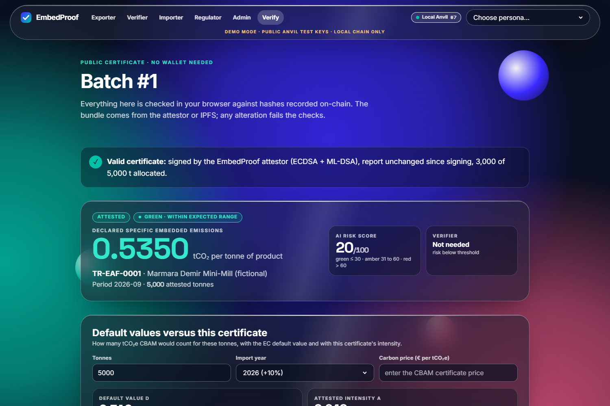
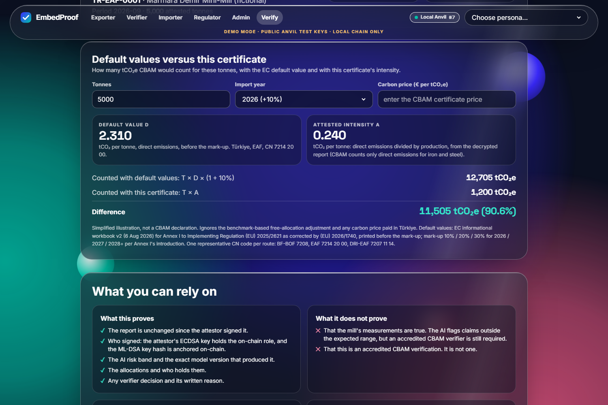
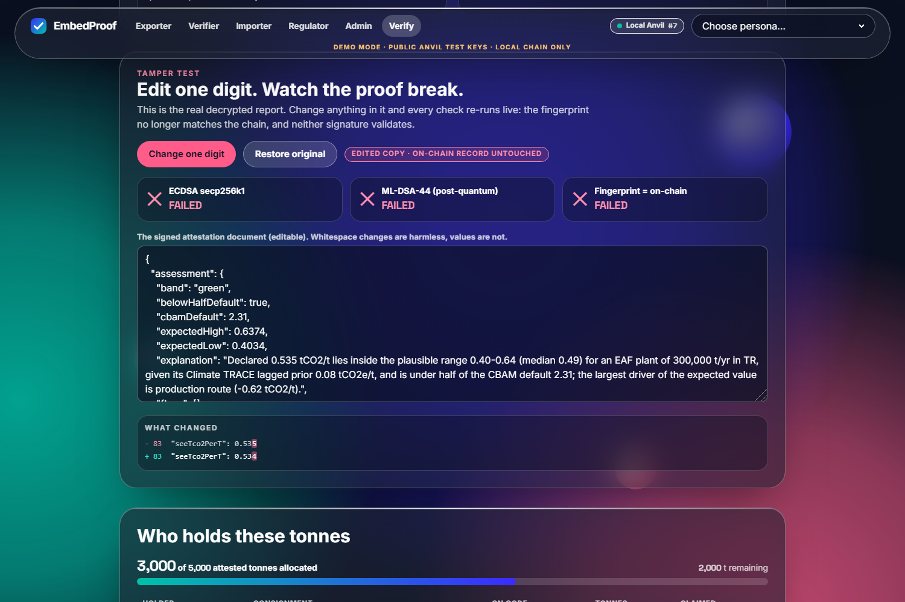
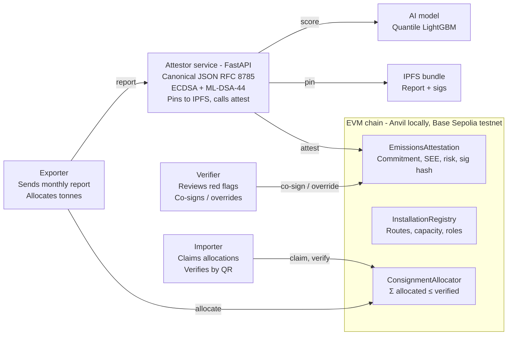

# EmbedProof

**Track 1 — Carbon Markets & Emissions Transparency** · IEEE ClimateChain Global Hackathon 2026

EmbedProof turns a steel mill's CO₂-per-tonne claim into a tamper-evident certificate with a
post-quantum signature. An AI model checks the claim for plausibility against Climate TRACE's
estimates for the plant, its route and its grid; the attestor signs every certificate with ECDSA
**and** ML-DSA-44 (FIPS 204); and a smart contract stops the same attested tonne being allocated to
two importers.

It is a verifier copilot and an anti-double-claim ledger. It is **not** a carbon-credit
marketplace, it issues no offsets, it does not touch Article 6 corresponding adjustments, and it
is **not** accredited CBAM verification under Reg. (EU) 2023/956. It is designed to support those
processes, not replace them.

## Why it matters: one shipment

Since 1 January 2026 an EU importer without trusted actual data declares the EC default value plus
a mark-up. For iron and steel only direct emissions count. For Turkish EAF rebar (CN 7214 20 00) the
default is 2.310 tCO₂e per tonne, before a mark-up of 10% in 2026, 20% in 2027 and 30% from 2028.

Take the honest demo mill's 5,000 t batch (`data/demo_reports/honest_eaf.json`). This is demo data:
direct emissions are 1,200 t, so 0.24 tCO₂e/t.

| 5,000 t of EAF rebar | 2026 (+10%) | 2028 onward (+30%) |
| --- | --- | --- |
| Counted at the default value | 12,705 tCO₂e | 15,015 tCO₂e |
| Counted with the attested actual value | 1,200 tCO₂e | 1,200 tCO₂e |
| Over-counted under the default | 11,505 tCO₂e | 13,815 tCO₂e |

The narrated video uses total SEE (0.535 t/t, which includes indirect emissions) instead of direct, the
conservative variant: 10,030 tCO₂e for 2026.

That gap is the price signal CBAM intends. It only reaches a Turkish mill that has decarbonised if
its buyer can trust the mill's real figure and claim it exclusively.

Multiply by the CBAM certificate price to get euros. The impact panel in the web app does this when
you enter a price; it never assumes one.

This is a simplified gross figure:
- It ignores the free-allocation adjustment and any carbon price paid in Türkiye.
- The importer can rely on an actual value only with accredited verification. EmbedProof makes that
  value cheap to check and stops it being allocated twice.

Sources and caveats: [`docs/STANDARDS.md`](docs/STANDARDS.md) §2.

[](https://youtu.be/-JmX905GWOQ)

4-minute narrated demo: <https://youtu.be/-JmX905GWOQ> · 20-second cut: [`brag-output/brag.mp4`](brag-output/brag.mp4)

| Certificate: plain verdict, then the checks | CBAM impact panel | Tamper test |
| --- | --- | --- |
|  |  |  |

`make up && make web` also enables a **live scenario runner** on the home page. The attestor plays
the honest, out-of-range and double-claim scenarios on the chain with its own demo accounts. On a
testnet, the rejected over-allocation is a mined transaction with an explorer link.

## The four demo flows

| # | Scenario | What you see |
| --- | --- | --- |
| a | Honest EAF mill | Report → AI plausibility band **green** → dual-signed, pinned, `attest()` → `Attested` |
| b | Implausible claim | BF-BOF mill declares EAF-level SEE → band **red** with SHAP reasons → `PendingVerifier` → verifier overrides with a reason hash → `Rejected` |
| c | Double claim | Exporter allocates 5,000 t to Importer A → tries the same 5,000 t for Importer B → reverts `DoubleClaimBlocked(batchId, 5000, 0)` |
| d | Tamper test | Change one digit of the off-chain report → commitment, ECDSA and ML-DSA checks all fail |

## Quickstart

Prerequisites: [Foundry](https://book.getfoundry.sh/getting-started/installation), Python 3.11 with
[uv](https://docs.astral.sh/uv/), Node 20+ with pnpm, GNU make, bash (Git Bash on Windows).

```bash
make setup     # one-time: venv + Python deps, forge build, ABI export, web deps
make demo      # fresh Anvil chain + contracts + attestor, runs scenarios a-d headless
```

For the UI:

```bash
make up        # Anvil + contracts + attestor, left running
make web       # http://localhost:3000 — demo personas switch between exporter, verifier, importer
make down
```

`make demo` takes about 33 s on the development laptop once caches are warm: 11.6 s of scenarios
plus chain start, deploy and the ~10 s rescore check. The first run on a fresh clone took 90 s,
because it compiles the contracts and loads the Python libraries for the first time. The committed model artefact and
fixtures mean nothing is downloaded or trained. `make test` runs the contract, model and attestor
test suites. `make train` regenerates the model and prints its `modelVersionHash`.

## Architecture

Confidential data stays off-chain with the attestor and IPFS; the chain holds only commitments,
risk bands, signature hashes and the allocation ledger.



| Component | Path | Stack |
| --- | --- | --- |
| Contracts | [`contracts/`](contracts/) | Solidity 0.8, Foundry, OpenZeppelin 5, UUPS behind a 24 h `TimelockController` |
| Attestor / oracle | [`attestor/`](attestor/) | Python 3.11, FastAPI, web3.py, RFC 8785 JCS, secp256k1 + ML-DSA-44, AES-256-GCM |
| AI plausibility model | [`model/`](model/), [`data/`](data/) | LightGBM quantile regression (q05/q50/q95), SHAP TreeExplainer |
| Web | [`web/`](web/) | Next.js 15, wagmi/viem, Tailwind, in-browser ML-DSA verification |
| Shared interface contract | [`docs/INTERFACES.md`](docs/INTERFACES.md) | ABI, report schema, bundle format, API |

### What is on-chain and what is not

| Data | Where | Why |
| --- | --- | --- |
| Installation ID, country, sector, route, capacity, operator | On-chain (`InstallationRegistry`) | Public reference for benchmarks and roles |
| Report commitment `keccak256(JCS(document))` | On-chain | Tamper evidence without disclosure |
| Declared SEE (tCO₂/t × 1e4), attested tonnes (exporter-declared, capped at nameplate capacity), risk score, status | On-chain | What importers and regulators need |
| Model-version hash, `algId`, `keccak256(ML-DSA sig)`, bundle digest (CID) | On-chain | Binds the record to the model and the PQ key; crypto-agility |
| Attestor and verifier addresses, reason hash | On-chain | Non-repudiation |
| Allocations: batch → consignment → importer, CN code, tonnes | On-chain (`ConsignmentAllocator`) | The double-claim guard |
| Full report, SHAP output, raw ECDSA + ML-DSA signatures, ML-DSA public key | IPFS bundle, report AES-256-GCM encrypted | Confidentiality; size (ML-DSA signature is 2,420 B) |

### How a certificate is checked

1. The attestor canonicalises the attestation document (report + AI assessment + chain id +
   contract address + 32-byte salt) with RFC 8785 and commits `keccak256` of it on-chain.
2. It signs every on-chain field, the commitment included, as EIP-712 typed data with secp256k1
   (the contract re-verifies this with `ecrecover` inside `attest()`), and signs the canonical bytes
   with ML-DSA-44.
3. The bundle (signatures, ML-DSA public key, AES-256-GCM ciphertext) is content-addressed; its
   SHA-256 digest is stored on-chain, so the CID is rebuilt and checked from chain data.
4. The certificate QR carries the decryption key in the URL fragment (`/verify/<id>#k=…`), which
   browsers never send to a server. Anyone with the certificate can decrypt, re-canonicalise,
   recompute the commitment and verify both signatures in the browser; anyone without it still
   sees the on-chain record and the ECDSA check.

## AI plausibility model

Trained on Climate TRACE v5.10.0 iron-and-steel plant-months (CC BY 4.0): 52,869 rows, 866 plants,
77 countries, routes BF-BOF / EAF / DRI-EAF. Features (FR-M1): production route, nameplate capacity,
country grid carbon intensity (Ember) and the plant's own Climate TRACE emissions factor as a lagged
prior (months m-14 to m-3, so at least two months old, as Climate TRACE publishes). Evaluation holds
out whole plants (173 test plants, scored once) and reports the no-history case separately:

| Check | With prior (9,208 rows) | Without prior (same rows) | Target |
| --- | --- | --- | --- |
| MAE of q50 vs route-median baseline | 0.042 vs 0.188 (78% better) | 0.088 (53% better) | ≥ 20% better |
| MAE of a no-model persistence forecast (plant's own lagged value) | 0.026, closer than the model | – | – |
| 90% interval coverage | 92.0% (CI 89.2–94.4%) | 92.3% | 85–95% |
| Recall at red, synthetic under-report at 0.5× | 0.97 | 0.84 — **missed** | ≥ 0.9 |
| Recall at red, synthetic under-report at 0.7× | 0.89 | 0.61 | ≥ 0.6 |
| Recall at red, synthetic under-report at 0.85× | 0.59 | 0.29 | – |
| False red on unmodified values | 1.3% | 1.3% | – |
| Inference incl. SHAP | ~5 ms | | < 500 ms |

With plant history every PRD target is met; a new plant with no Climate TRACE history misses the 0.5×
recall target, and DRI-EAF detection is weak in both regimes (12 test plants). The ground truth is
Climate TRACE's own modelled estimate, so these numbers measure consistency with Climate TRACE and its
history, not accuracy against measured plant emissions; a plain persistence forecast is even closer on
point error (MAE 0.026), and the model's value is the calibrated interval and the no-history branch.
The artefact is frozen in `model/artefacts/embedproof_model_v1.json`; its SHA-256 is the on-chain
`modelVersionHash` (`0x40d9ee13…08c8`) and `make train` reproduces it byte for byte.

Türkiye slice (4 held-out plants, 230 plant-months with a prior; **not statistically powered**):
- q50 MAE 0.049 vs 0.104 for the route median; persistence is as close (0.049).
- 90% coverage 86.5%. One BF-BOF plant at 62.5% pulls this down; the three EAF plants are at 93–95%.
- Recall at red: 100% at 0.5× and 70% at 0.7×.
- File: [`model/artefacts/eval_slices.json`](model/artefacts/eval_slices.json).

Full model card: [`model/MODEL_CARD.md`](model/MODEL_CARD.md). Data sources and licences:
[`data/SOURCES.md`](data/SOURCES.md).

Risk score: `r = 100 · clip((q05 − SEE_declared) / (q50 − q05), 0, 1)`, plus 20 when the declared
value is below half the CBAM default for the route.
- Bands: green ≤ 30; amber 31–60 (attests, with a visible flag); red > 60 (`PendingVerifier` until
  a verifier decides).
- The +20 rule is implemented as the PRD specifies, but it fires for most honest EAF mills,
  because the EC steel defaults are BF-BOF scale. The honest demo mill scores 20 for that reason.
- Two informational flags never change the score: a declared grid factor below 0.8 × Ember's, and
  electricity per tonne outside 0.5×–2× of Climate TRACE's route assumption.
- The model flags plausibility; it does not measure CO₂.

**Check a score yourself.** `python -m attestor.rescore "<certificate URL>"`:
- decrypts the bundle and re-runs the scorer on the exact inputs stored in the assessment;
- checks that the model artefact's SHA-256 equals the on-chain `modelVersionHash` and that the
  recomputed score equals the on-chain `riskScore`.

`make demo` runs it on the green certificate.

## Contracts

- 185 Foundry tests (unit, fuzz, stateful invariants incl. revoke-and-resubmit, EIP-712 replay matrix, upgrade-through-timelock), 100% line, branch
  and function coverage on all three contracts (`make coverage`).
- Gas on the transaction receipt: `attest()` 227,997 (budget 250k); first `allocate()` on a batch
  117,952 (budget 120k).
- Every privileged call is role-gated in the registry; one global pause stops `attest`,
  `verifierSign`, `allocate` and `claim`; upgrades only through the 24 h `TimelockController`; only
  admin-approved model hashes can attest, and a model can be revoked; the attestor's ML-DSA-44 public
  key hash is anchored in the registry and the attestor refuses to sign if it is not.

| Contract | Local Anvil (deterministic) | Base Sepolia |
| --- | --- | --- |
| InstallationRegistry | `0x9fE46736679d2D9a65F0992F2272dE9f3c7fa6e0` | not yet deployed — needs a funded key (`make deploy-testnet`) |
| EmissionsAttestation | `0xDc64a140Aa3E981100a9becA4E685f962f0cF6C9` | not yet deployed |
| ConsignmentAllocator | `0x0165878A594ca255338adfa4d48449f69242Eb8F` | not yet deployed |
| TimelockController (24 h) | `0x5FbDB2315678afecb367f032d93F642f64180aa3` | not yet deployed |

Hyperledger Besu (permissioned, same Solidity) is the production path for a consortium of
exporters, verifiers and the regulator.

## Security, threat model and privacy

The chain guarantees integrity after data entry, not the truth of the data; the AI gate, verifier co-signature and dual signatures cover the rest.

### STRIDE threat model

| Threat | Category | Attack | Mitigation | Residual risk |
| --- | --- | --- | --- | --- |
| Falsified production or emissions report | Tampering / Repudiation | Exporter declares EAF-level intensity for a BF-BOF plant, or inflates tonnes | AI plausibility gate against Climate TRACE, route and grid data; red → mandatory verifier co-sign; attested tonnes capped at nameplate capacity | Collusion between exporter and verifier; plausible-but-false figures |
| Oracle manipulation | Tampering | Compromised attestor signs bad data | Attestor key separate from operator; model-version hash on-chain; verifier co-sign required above threshold; design follows the secure-oracle framework of [Iqbal et al., 2024](https://www.researchgate.net/publication/383150143_Bridging_Two_Worlds_Framework_for_Secure_Implementation_of_Blockchain_Oracles) | Single attestor in prototype; roadmap: 2-of-3 attestors |
| Double-claiming of attested tonnes | Spoofing / Elevation | Two importers claim the same batch, or a batch is revoked and resubmitted to reset the cap | Allocation cap per installation-period (survives revoke and resubmit); consignment ID uniqueness; `DoubleClaimBlocked` revert | Claims made outside EmbedProof are not visible to the chain |
| Sybil verifiers | Spoofing | Attacker registers fake verifier wallets | `VERIFIER` role granted only by admin against accreditation list; roadmap: on-chain accreditation registry | Admin key compromise |
| Key compromise (operator, attestor, verifier) | Spoofing | Stolen key signs or allocates | Role revocation; pause; timelock on upgrades; PQ signature binds report to attestor's ML-DSA key | Prototype uses EOAs, not HSM |
| Replay of a valid attestation | Tampering | Re-submit an old report for a new period | Commitment includes installation + period; duplicate period reverts | None |
| Front-running an allocation | Tampering | Importer B sees A's pending allocate and races it | Allocation only callable by exporter; importer cannot self-allocate | None |
| Model poisoning | Tampering | Adversary skews training data so underreports score green | Public training data snapshot hashed in repo; model-version hash on-chain; retrain requires admin and new hash | Climate TRACE upstream errors |
| Harvest-now, forge-later | Repudiation | Quantum adversary forges ECDSA on records kept for years | Hybrid ECDSA + ML-DSA-44 (FIPS 204); `algId` field for crypto-agility | On-chain verification is ECDSA only today |
| Confidential plant data leakage | Information disclosure | Competitor reads production volumes on public chain | Report, electricity data and SHAP output encrypted off-chain; on-chain only commitment, SEE, risk band and attested tonnes (the cap needs them); roadmap: ZK range proof | Monthly attested tonnes and SEE are public, so production volume is readable |
| Denial of service on attestor | DoS | Flood `/score` | Rate limit; `attest()` only from attestor key | Prototype runs single instance |

### Post-quantum signing

- Algorithm: ML-DSA-44 (FIPS 204, Aug 2024).
  - The attestor signs with PQClean's C implementation through `pqcrypto`.
  - liboqs is an optional backend in the Docker image (`WITH_LIBOQS=1`); it was not exercised in our runs.
  - `dilithium-py` is a reference-only fallback.
  - Tests cross-check the backends.
- Sizes: public key 1,312 B, signature 2,420 B. Too large for cheap on-chain storage, so the signature and key live in the IPFS bundle; only `keccak256(sig)` and `algId = 1` go on-chain.
- Verification: in the browser with `@noble/post-quantum` (pure JS), against signatures produced by PQClean.
- Key lifecycle:
  - The trust anchor is the hash of the attestor's ML-DSA public key, set on-chain by the admin
    (`setAttestorPqKey`), and the attestor refuses to sign until it matches.
  - Rotation anchors a new hash; the old one stays valid for old certificates (`isAttestorPqKey`).
  - A compromised key is revoked with `revokeAttestorPqKey`, and every certificate it signed then
    fails its PQ check.
  - Limit: the anchor is written by an ECDSA-signed admin transaction, so the chain's own
    transaction signatures also need a post-quantum migration before the anchor is quantum-safe.
  - Until then, a verifier can pin the published key hash out of band.
- Why it is defensible, not theatre: CBAM records are retained for years; a compliance record forged in 2032 against a 2027 ECDSA signature would be indistinguishable from a real one. Native on-chain PQ verification is the stated migration path.

### Privacy design (as built)

- On-chain: installation ID, period, SEE, attested tonnes, risk band, commitment, CID digest,
  signature hashes, allocations (consignment, importer, CN code, tonnes).
- Off-chain, AES-256-GCM encrypted: the full report, electricity data and SHAP output. The bundle
  also carries the signatures and the ML-DSA public key in clear; these are public by nature.
- Roadmap: per-field selective disclosure, a lattice-based ZK range proof that SEE ≤ benchmark
  without revealing it, and a permissioned Besu deployment.

More detail:

- The attestor's ECDSA signature is EIP-712 typed data over every on-chain field (installation,
  period, commitment, SEE, tonnes, risk score, model hash, `algId`, ML-DSA signature hash) with the
  chain id and contract address in the domain, so a signature cannot be replayed to another period,
  another number set, another chain or another contract. `attest()` re-verifies it with `ecrecover`.
- Attested tonnes per batch and per consignment are public on-chain: the double-claim cap needs them.
- The report decryption key goes to the exporter (in the `/attest` response), and through signed
  `/disclosure` requests to the verifier, the regulator, the installation operator and importers who
  hold an allocation on that batch; the certificate QR carries it in the URL fragment.
- There is one salt per document, so disclosure is all-or-nothing; per-field selective disclosure
  is roadmap, alongside ZK range proofs.
- Accepted residual risks: consignment ids are global (FR-C6), so a second registered operator can
  grief an id; the CN code is not bound to the batch; the admin can grant roles instantly (upgrades
  and the risk threshold go through the 24 h timelock).

## Why a blockchain, not a database

A Turkish mill, its EU importers, an accredited verifier and a regulator don't share an IT system,
and none of them should have to trust another to run the allocation ledger.
- The contract enforces allocated ≤ attested tonnes per installation-period for everyone at once.
- Revocations and verifier decisions are attributable to a key.
- The record outlives any one company's server; CBAM records are kept for years.

A shared database run by one party would need every other party to trust that party's admin. In
production the same Solidity runs on a permissioned Besu network operated by the participants.

## Related work

| Approach | What it does | What EmbedProof adds |
| --- | --- | --- |
| EU CBAM Registry | Declarants file declarations and surrender CBAM certificates | A supplier-side ledger, so one mill's attested tonnes cannot be claimed by two importers |
| Climate TRACE | Independent modelled emissions per facility | A signed per-batch claim checked against that estimate (we use it as the AI's prior) |
| Site certification for steel (e.g. ResponsibleSteel) | Certifies a site against a standard | Per-batch, per-importer allocation records |
| Book-and-claim registries | Track environmental attributes separately from goods | Allocation bound to a consignment id and CN code |
| Blockchain oracle frameworks ([Iqbal et al., 2024](https://www.researchgate.net/publication/383150143_Bridging_Two_Worlds_Framework_for_Secure_Implementation_of_Blockchain_Oracles)) | Patterns for trustworthy off-chain data | We follow them: a separate attestor key, the model hash on-chain, human co-sign above a risk threshold |

## Scale and cost

These figures use the measured gas numbers. Every steel plant in our Climate TRACE dataset (866)
attesting monthly is 10,392 `attest()` calls a year × 227,997 gas = 2.37 × 10⁹ gas a year, before
allocations. Cost is that figure times the gas price; on an L2, add the L1 data fee. We do not
assume a price.

At the measured 1.3% false-red rate, a fully honest population would send about 135 of those 10,392
monthly reports a year to a verifier unnecessarily.

## Standards

- CBAM: a field-by-field table of our report against the 16 items of the operator's summary
  emissions report is in [`docs/STANDARDS.md`](docs/STANDARDS.md). We cover route, production,
  direct emissions and SEE. We do not cover heat flows, waste gases, capture or precursors.
- IEEE 2418.2-2020 and IEEE 3205-2023 informed the design: typed and versioned records, canonical
  encoding, chain-bound signatures, and an algorithm id. We have not mapped our formats to them
  field by field and claim no conformance. IEEE P2418.5 is a working group.

## Limitations and what we did not build

- The chain guarantees integrity after data entry, not the truth of the data. Collusion between
  an exporter and a verifier is not prevented, only made attributable.
- One attestor key in the prototype (roadmap: 2-of-3 attestor quorum). Keys are EOAs, not HSMs.
- ML-DSA is verified off-chain (browser and attestor); on-chain verification is ECDSA only today.
- The model is trained on public facility estimates, which are themselves modelled. It is an
  activity-proxy plausibility check, not a measurement. It covers steel only; the registry's cement
  routes have no model.
- Attested tonnes are the exporter's declaration, bounded only by nameplate capacity (+20% per month).
- A plant gets a Climate TRACE history only through the admin-maintained installation file
  (`INSTALLATIONS_FILE`). Without one, the no-history branch applies, and it misses the 0.5× recall
  target.
- Not deployed to a public testnet or hosted yet (needs the team's keys and accounts); IPFS
  pinning falls back to a local content-addressed store when `PINATA_JWT` is unset.
- No ZK range proofs yet (roadmap), no offsets or credits, no Article 6, no mainnet, no mobile app.

## Licence and data credits

Code: MIT ([`LICENSE`](LICENSE)). Data: Climate TRACE (CC BY 4.0) and other sources listed with
their licences in [`data/SOURCES.md`](data/SOURCES.md).
